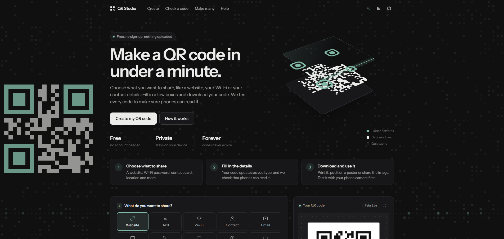
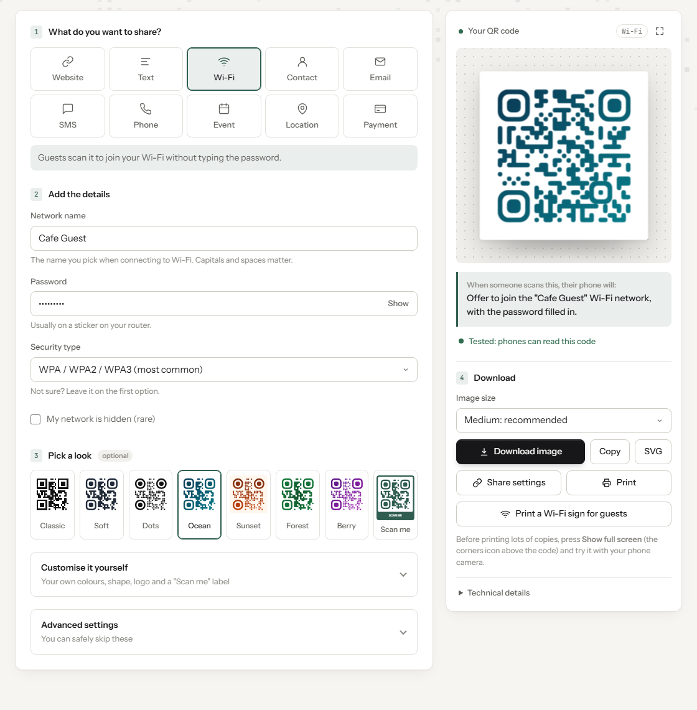
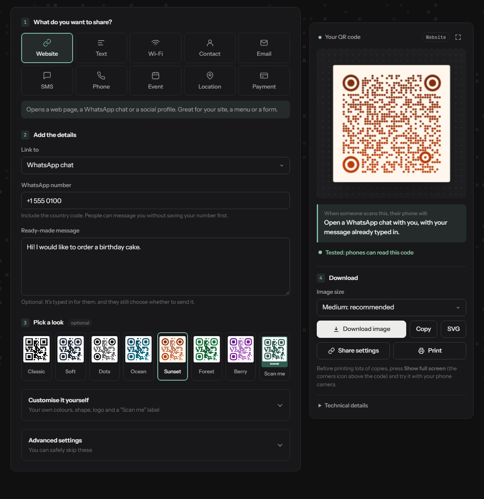
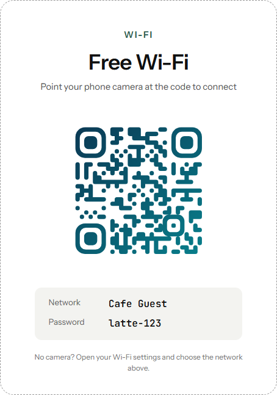
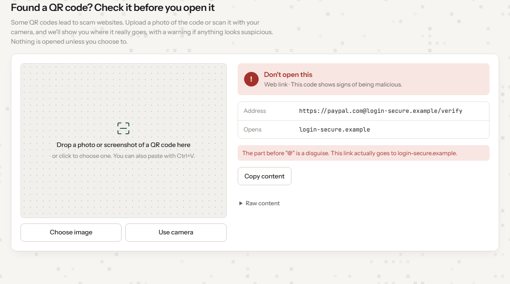
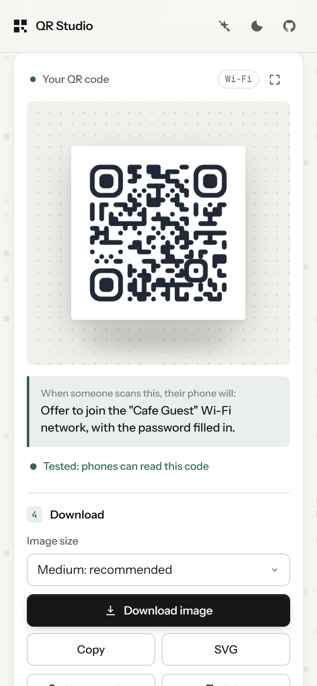

# QR Studio

Make a QR code in under a minute: for a website, WhatsApp, your Wi-Fi, a contact card, an event and more. Every code is tested to make sure phones can read it. It runs entirely in your browser, works offline, and nothing you type is uploaded.

**[Open the live app →](https://haseeb35.github.io/QR-STUDIO-/)**



## A quick tour

### Create a code in four steps

Pick what to share, fill in a few boxes, choose a look and download. The preview explains in plain words what happens when someone scans the code, and a built-in scanner confirms that phones can read it.



### WhatsApp and social links from just a username

Choose WhatsApp, Instagram, Facebook, YouTube, TikTok, LinkedIn or X, type a username or phone number, and the right link is built for you. WhatsApp codes can include a ready-made message.



### A printable Wi-Fi sign for guests

Turn a Wi-Fi code into a tidy card with the network name and password, ready for a café table, reception desk or fridge.

<p align="center">
  
</p>

### Check a QR code before you open it

Some QR codes lead to scam websites. Upload or scan a code to see where it really goes. Suspicious links get a clear warning, and nothing opens unless you choose to.



### Works on your phone

<p align="center">
  
</p>

## Features

**Code types**

| Type | Encodes as |
| --- | --- |
| Website | Any link, or a shortcut: WhatsApp chat (`wa.me`, with optional ready-made message), Instagram, Facebook, YouTube, TikTok, LinkedIn or X from just a username |
| Text | Plain text, including Unicode and emoji |
| Wi-Fi | `WIFI:T:WPA;S:…;P:…;;` (phones join the network) |
| Contact | vCard 3.0 |
| Email | `mailto:` with subject and body |
| SMS | `SMSTO:number:message` |
| Phone | `tel:` |
| Event | iCalendar `VEVENT` (times stored in UTC) |
| Location | Google Maps link or `geo:` URI, with "use my location" |
| Payment (UPI) | `upi://pay` payment link |

**Design**

- Eight ready-made designs, each tested to scan with every code type, with or without a logo
- Module styles: square, rounded, dots
- Corner styles: square, rounded, circle
- Solid colour or linear/radial gradient
- Centre logo: error correction switches to High automatically
- Frames: caption below the code, or a box frame with a caption band

**Checks**

- **Scan check:** every code is decoded in the browser with [jsQR](https://github.com/cozmo/jsQR) and marked *Scans correctly* only if the decoded text matches exactly
- **Contrast warning:** flags low contrast and light-on-dark codes

**Export and workflow**

- PNG (512 / 1024 / 2048 px), SVG, copy to clipboard, print
- **Full-screen view:** shows the code large on screen to test with a phone
- **Wi-Fi sign:** a printable guest card with the code, network name and (optionally) the password
- **History:** the last 10 exported codes, stored in your browser
- **Share links:** settings are encoded in the URL hash, so nothing reaches a server. Optionally locked with a passphrase.
- **Batch:** upload a CSV and get a ZIP with one PNG per row, or a printable sheet. Use *Template* to get the right columns for the selected type. Optional `filename` and `caption` columns.
- **Installable PWA:** works offline after the first visit

**Animated background**

A faint field of QR modules twinkles behind the page. Every few seconds a real, scannable QR code assembles in the side margins and dissolves again; point a phone at one to read its hidden message. A scanner beam sweeps the screen, modules glow near the cursor, and clicks send out ripples. Animations follow the system *reduce motion* setting until you click the sparkle button in the top bar, which overrides it.

**Check a QR code**

Drop, paste or scan (camera) any QR code to see what it contains before opening it. It shows the destination, flags phishing signs, and never opens anything automatically.

## Security

| Protection | What it does |
| --- | --- |
| Dangerous-link blocking | Refuses to encode `javascript:`, `data:`, `file:`, `vbscript:`, `blob:` and similar links |
| Link warnings | Flags `http`, raw IP addresses, lookalike (punycode) domains, link shorteners, unusual ports and `user@host` disguises |
| QR checker | Decodes locally, shows content as plain text, gives a verdict, and hides the open button for dangerous links |
| Password handling | Wi-Fi passwords are never saved to history and are left out of share links unless you opt in |
| Locked share links | AES-256-GCM, with a key derived from your passphrase using PBKDF2-SHA256 (310,000 iterations), via the Web Crypto API |
| Content Security Policy | Only same-origin scripts, styles, fonts and workers; no plugins, `<base>`, form posts or frames |
| No third parties | Fonts and libraries are self-hosted, so pages make no outside requests. `no-referrer` on all links |
| Input validation | Settings from links and storage are allow-listed before rendering; field lengths and upload sizes are capped; SVG logos are converted to PNG |
| Supply chain | `SHA256SUMS` records each bundled file; the *Integrity* workflow fails if one changes. CodeQL scans the code weekly |

See [SECURITY.md](SECURITY.md) for how to report a vulnerability.

**If you fork this project,** turn these on under **Settings → Code security**: private vulnerability reporting, Dependabot alerts and secret scanning. Then add a branch protection rule for `main` that requires the *Integrity* and *CodeQL* checks to pass.

## Run locally

No build step. Open `index.html` directly, or serve the folder to enable offline mode and installation (service workers need http):

```bash
npx serve .
```

## Deploy to GitHub Pages

1. Push this folder to a GitHub repository.
2. Go to **Settings → Pages**, set the source to the `main` branch at `/ (root)`.
3. The site will be live at `https://<username>.github.io/<repo>/`.

When you change files listed in `sw.js`, bump its `VERSION` so returning visitors get the update.

## Project structure

```
index.html            Page markup
styles.css            Design tokens, light/dark themes, layout, print styles
js/prefs.js           Theme and motion preferences (loaded in <head>)
js/background.js      Animated QR field behind the page
js/payloads.js        Code types: fields, encoding, labels
js/security.js        Link analysis, content inspection, share-link encryption, limits
js/render.js          QR matrix → SVG / canvas, styles, logo, frames, scan check
js/batch.js           CSV parsing, ZIP export, print sheets
js/motion.js          3D hero, card tilt, scan beam, flip animation
js/inspect.js         "Check a QR code" (image, paste and camera)
js/app.js             UI wiring, history, share dialog, PWA
sw.js                 Offline cache
vendor/               qrcode-generator, jsQR, JSZip (bundled for offline use)
fonts/                Instrument Sans, JetBrains Mono (SIL Open Font License)
SHA256SUMS            Hashes of every bundled third-party file
SECURITY.md           Vulnerability reporting and security design
docs/screenshots/     Images used in this README
.github/              CodeQL, integrity check, Dependabot
```

If you update a library or font, regenerate the hashes with `sha256sum vendor/* fonts/* > SHA256SUMS`.

## How it works

1. The selected type turns its form fields into a payload string.
2. [qrcode-generator](https://github.com/kazuhikoarase/qrcode-generator) encodes the payload into a grid of modules.
3. `render.js` builds the code's shapes as SVG path data. Finder and alignment patterns are drawn as solid shapes so styled codes still scan.
4. The same path data is used for the SVG preview and, through `Path2D`, for PNG export.
5. The rendered image is decoded again to confirm it scans.

## Tech

HTML, CSS, vanilla JavaScript. No framework, no build step.
